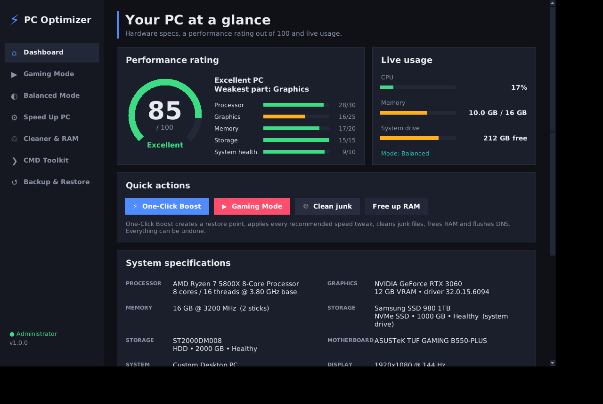

# ⚡ PC Optimizer

A Windows desktop app that shows your PC's specs, rates it out of 100, and speeds it up:
Gaming Mode, Balanced Mode, registry and Windows tweaks, a junk cleaner, a RAM booster
and a toolkit of maintenance commands. **Every change it makes is backed up and can be undone.**



## Features

| Section | What it does |
|---|---|
| **Dashboard** | Full specs (CPU, GPU + VRAM, RAM speed and sticks, every drive and its type, motherboard, display, Windows build), a **performance rating out of 100** with a per-component breakdown and your weakest part, live CPU/RAM/disk usage, **CPU and GPU temperatures and GPU load**, and **One-Click Boost**. |
| **AI Assistant** | Chat with Claude (Anthropic's AI) in plain words, for example "my games stutter", "my Wi-Fi keeps dropping" or "turn on night light". It checks your PC with read-only tools and diagnostic commands, then fixes the problem with the app's own optimizations, cleaner, startup manager, Windows commands or registry edits. **It asks your permission before every change** and shows exactly what it will do. Its registry edits are backed up and can be undone in Backup & Restore. It can also open the right Windows Settings page for you. |
| **Screen Time** | How long you use each app, with **Daily**, **Weekly** and **Monthly** views. Each view shows total time, the daily average, the change from the previous period, your most used app, a chart (by hour for a day, by day for a week or month) and a ranked list of apps. Use the arrows to look back at earlier days, weeks and months. |
| **Gaming Mode** | Ultimate Performance power plan, Game Mode, background recording (Game DVR) off, hardware-accelerated GPU scheduling, CPU/GPU priority for games (MMCSS), no network throttling, no CPU power throttling, raw mouse input. Lists RAM-heavy background apps so you can close them, and gives driver and in-game setting tips based on your GPU, RAM and monitor. |
| **Game Profiles** | Add each game's `.exe`. Every game gets **High CPU priority** and the **high-performance GPU**, and you can turn off fullscreen optimizations per game. **Boost & Launch** switches to Gaming Mode, frees RAM, flushes DNS and starts the game as your normal user. |
| **Balanced Mode** | Switches to the Balanced power plan and puts back your original values for the power-hungry gaming tweaks. Your general speed tweaks stay on. Use it for everyday work and battery life. |
| **Speed Up PC** | Visual effects set to best performance (smooth fonts kept), transparency off, no startup-app delay, faster menus, Store apps stopped from running in the background, ads and suggestions off, web results removed from Start search, less telemetry, faster shutdown, NTFS last-access timestamps off, optional hibernation off. Also has a **startup-apps manager** that works the same way as Task Manager. |
| **Services** | **Disable** services you don't use. Recommended ones are ticked by default: telemetry, WAP Push, Maps, Retail Demo, Fax, Error Reporting, Remote Registry, Link Tracking, Media Player sharing, AllJoyn, Insider and Phone Service. Optional ones (Print Spooler, Xbox, Geolocation, Search indexing, SysMain, Bluetooth, Remote Desktop, Parental Controls, Smart Card, Program Compatibility) each come with a warning about what stops working. Undo puts back the original startup type. **Running services** lists everything running now so you can **stop** or start services; services Windows needs are protected. |
| **Driver Updates** | Checks **Windows Update** for driver updates for your hardware and installs the ones you pick, after creating a restore point. Every driver offered is signed and approved by Microsoft. Also shows your **graphics driver's** version and age with a button to the maker's official download page (NVIDIA, AMD or Intel), lists **devices with problems** (missing driver, failed to start...), lists installed drivers oldest first with ones over 3 years old highlighted, and can **back up all drivers** to your Documents folder. |
| **Cleaner & RAM** | Scans and cleans user and Windows temp files, the Windows Update cache, the Delivery Optimization cache, thumbnail caches, crash dumps, old logs, browser caches and the Recycle Bin. **Free up RAM** trims the memory every app holds, and you can flush the DNS cache. |
| **CMD Toolkit** | 33 one-click commands, with live output. **Cleanup:** temp files (yours and Windows'), Prefetch, Recycle Bin, thumbnail/icon cache, Delivery Optimization cache, Microsoft Store cache. **Repair:** SFC, DISM, chkdsk, reset Windows Update. **Storage:** WinSxS cleanup, TRIM/defrag, Disk Cleanup. **Network:** flush DNS/ARP, renew IP, reset Winsock/TCP, TCP auto-tuning, show saved Wi-Fi passwords. **Diagnostics:** disk health, battery report, power report, what's keeping the PC awake, RAM test, startup list, system summary, activation status. **System:** restore point, update all apps (winget), restart Explorer, power plans, open Registry Editor. Commands that delete things or show passwords ask for confirmation first. You can also run your own commands. |
| **Registry** | Browse and edit the registry: jump to common keys, view subkeys and values, and create, edit or delete values (strings, numbers, binary, multi-string). **Every change is backed up**: the old value is saved so you can undo it in Backup & Restore, and the whole key is exported to a `.reg` file in `%LOCALAPPDATA%\PCOptimizer\registry-backups` first. Critical keys show a warning. |
| **Benchmark** | A roughly 20-second test of single-core and all-core CPU, RAM copy speed, disk write speed, 4K disk writes, background CPU load and free RAM. Your first run is saved as **Before**, and later runs show **After** with the % change for each test. |
| **Backup & Restore** | Create a restore point, see every change that's currently applied, undo changes one by one or all at once, and open System Restore. |

## Getting it on your PC

### Option A: download the ready-made .exe (easiest)
1. Open this repository on GitHub and go to **Actions → "Test & build Windows app"**.
2. Open the latest green run and download the **PCOptimizer** artifact (a zip).
3. Unzip it and double-click **PCOptimizer.exe**. Click **Yes** on the administrator prompt.

> Windows SmartScreen may warn about an unsigned app: click **More info → Run anyway**.

### Option B: run from source
1. Install **Python 3.10+** from [python.org](https://www.python.org/downloads/) and tick **"Add python.exe to PATH"**.
2. Download this repository (**Code → Download ZIP**) and unzip it.
3. Double-click **`run.bat`**.

To build your own `.exe`, double-click **`build_exe.bat`**. The file ends up in `dist\PCOptimizer.exe`.

## Setting up the AI Assistant
1. Create an account at [console.anthropic.com](https://console.anthropic.com), add credit under
   **Billing**, and create a key under **Settings → API keys**.
2. Open **AI Assistant** in the app, paste the key (it starts with `sk-ant-`) and click **Save key**.
   The key is encrypted with Windows' built-in protection, so only your Windows account can read it.
   You can also set the `ANTHROPIC_API_KEY` environment variable instead.
3. Ask anything. Usage is billed by Anthropic to your account: a typical question costs a few cents.

The assistant uses Claude Opus 5.5. It will not turn off Windows Defender, the firewall, UAC or
Windows Update, or delete your personal files.

## About Screen Time
Windows doesn't let other apps read its own usage history, so PC Optimizer records it itself from the
moment you turn tracking on. Earlier usage can't be shown. A small background tracker starts when you sign in
(a Task Scheduler task called *PC Optimizer Screen Time*, which runs without a UAC prompt) and checks
which app is in front every 5 seconds. It uses almost no CPU or RAM.
- **Counted:** time in the app in front while you're using the PC. Watching a video or playing
  with a controller still counts, because Windows reports the screen is being kept on.
- **Not counted:** time when the PC is locked or asleep, or when you've been away for 5+ minutes.
- **Private:** only app names and minutes are saved, in `%LOCALAPPDATA%\PCOptimizer\screentime.db`.
  Window titles, websites and typing are never recorded. **Clear history** deletes everything.

## Recommended first run
1. **Benchmark → Run benchmark** to record your "before" score.
2. **Backup & Restore → Create restore point**
3. **Dashboard → One-Click Boost**
4. **Gaming Mode → Activate** if you play games, or **Balanced Mode** for work.
5. **Game Profiles**: add your games.
6. **Services → Disable selected** (the recommended ones are already ticked).
7. **Speed Up PC → Startup apps**: disable anything you don't need at boot.
8. **CMD Toolkit**: run *Repair Windows image (DISM)* and then *Repair system files (SFC)* once.
9. **Restart your PC**, then run the **Benchmark** again to see the difference.

## About temperatures
- **CPU temperature** comes from Windows' built-in thermal sensors. Many desktop motherboards don't
  report a real CPU temperature to Windows, and then the app shows *n/a*. For exact per-core
  readings, use a tool like HWiNFO.
- **GPU temperature and fan speed** come from `nvidia-smi`, which is installed with NVIDIA drivers.
  **GPU load** works on every brand of graphics card.

## Safety
- Before it changes a registry value, the app saves the original to
  `%LOCALAPPDATA%\PCOptimizer\tweak_backup.json`. **Undo** writes that original value back
  exactly, and deletes values that didn't exist before.
- Nothing here turns off Windows Defender, the firewall, Windows Update or other security features.
- Startup apps are disabled the same way Task Manager does it. Nothing is deleted.
- The cleaner skips files that are in use, temp files newer than 2 hours, and any path that isn't absolute.
- Windows system processes are hidden and protected in the "Close background apps" list.

## Development
```bash
pip install -r requirements-dev.txt
python -m pytest -q             # core logic tests (run on any OS)
python -m pcoptimizer --demo    # preview the UI with sample data; changes nothing
```

Project layout:
```
pcoptimizer/
  system_info.py   hardware detection (one PowerShell/CIM call) and live CPU/RAM meters
  rating.py        0-100 scoring
  tweaks.py        reversible tweak catalogue and JSON backup manager
  profiles.py      Gaming / Balanced modes
  cleaner.py       junk scanning and cleaning, RAM trimming
  processes.py     background apps and startup-app manager
  commands.py      CMD Toolkit catalogue
  services.py      optional services that can be disabled
  games.py         per-game profiles
  sensors.py       temperature and GPU readings
  benchmark.py     before/after benchmark
  ai_assistant.py  Claude-powered assistant: tools, approval gate, read-only command detection
  ai_settings.py   API key storage (Windows DPAPI)
  regedit.py       registry editor with per-value undo and .reg backups
  drivers.py       Windows Update driver search/install, driver inventory, problem devices
  screentime.py    screen time tracker, storage and daily/weekly/monthly reports
  backend.py       facade used by the UI, plus a demo backend
  ui/              Tkinter interface (theme, widgets, pages)
```
